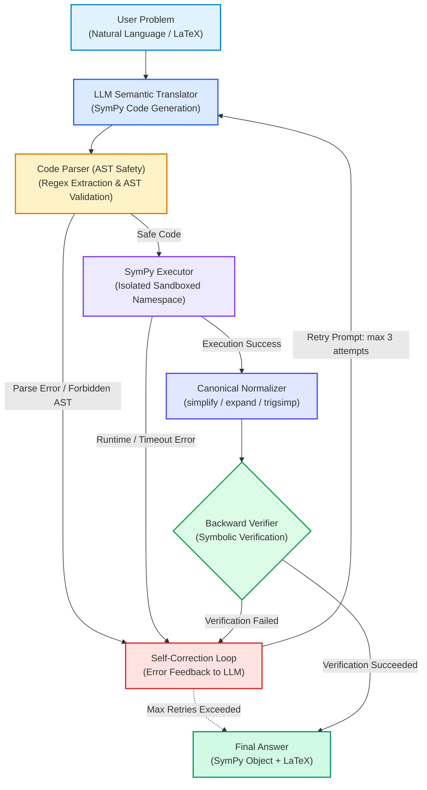

# Архитектура гибридной системы решения задач матанализа: комбинация символьных вычислений (SymPy) и языковых моделей для верифицируемого ответа

[](https://www.python.org/)
[](LICENSE)
[](tests/)
[](https://www.sympy.org/)

## О проекте

Проект посвящен разработке нейросимволической (гибридной) системы для решения задач математического анализа, объединяющей языковые модели (LLM) и систему компьютерной алгебры SymPy. Языковая модель выступает в роли семантического транслятора, преобразующего условие задачи на естественном языке или LaTeX в исполняемый Python-код, в то время как детерминированный символьный движок гарантирует математическую точность и исключает галлюцинации нейросети. Архитектура включает многоуровневый контроль безопасности (AST-валидатор), каноническую нормализацию, обратную верификацию результатов и замкнутый цикл самокоррекции (Self-Correction Loop), что обеспечивает строгую верифицируемость каждого полученного ответа.

---

## Архитектура пайплайна

Гибридный пайплайн последовательно трансформирует исходную задачу в строго доказанное символьное решение:



---

## Структура проекта

```text
neuro-symbolic-ai/
├── src/
│   ├── __init__.py            # Инициализация пакета
│   ├── llm_client.py          # Клиент LLM (OpenAI-compatible, Gemini API, Mock)
│   ├── parser.py              # Извлечение кода и AST-валидатор безопасности
│   ├── verifier.py            # Изолированный SymPy-исполнитель и верификатор
│   └── pipeline.py            # Оркестратор пайплайна и Self-Correction Loop
├── data/
│   └── calculus_dataset.json  # Датасет задач по матанализу (пределы, производные, интегралы, ряды)
├── tests/
│   ├── __init__.py
│   └── test_pipeline.py       # Набор модульных тестов (pytest)
├── results/
│   └── benchmark_report.json  # Результаты запусков бенчмарка
├── benchmark.py               # Скрипт сравнительного бенчмарка (Hybrid vs Baseline)
├── requirements.txt           # Зависимости проекта
├── .env.example               # Шаблон конфигурации переменных окружения
├── .gitignore                 # Исключения Git
└── README.md                  # Документация проекта
```

---

## Установка

### 1. Клонирование репозитория
```bash
git clone https://github.com/your-username/neuro-symbolic-ai.git
cd neuro-symbolic-ai
```

### 2. Создание и активация виртуального окружения
```bash
# Создание venv
python -m venv venv

# Активация на Windows (PowerShell / CMD):
venv\Scripts\activate

# Активация на Linux / macOS:
source venv/bin/activate
```

### 3. Установка зависимостей
```bash
pip install -r requirements.txt
```

### 4. Настройка переменных окружения
```bash
cp .env.example .env
# Отредактируйте .env и укажите ваш API-ключ и параметры модели
```

---

## Быстрый старт

Пример решения задачи математического анализа с использованием гибридного пайплайна:

```python
import os

# Включение mock-режима для автономной работы без обращения к API
os.environ["MOCK_MODE"] = "true"

from src.pipeline import MathPipeline, PipelineConfig

# Инициализация пайплайна с лимитом до 3 попыток самокоррекции
pipeline = MathPipeline(config=PipelineConfig(max_retries=3))

# 1. Решение задачи в гибридном режиме (LLM -> SymPy -> верификация)
hybrid_result = pipeline.solve_hybrid(
    problem="Найдите предел sin(x)/x при x->0",
    task_type="limit",
)

print("--- Гибридный режим ---")
print(f"Успех:           {hybrid_result.success}")
print(f"Число попыток:   {hybrid_result.attempts}")
print(f"Символьный ответ: {hybrid_result.sympy_result}")
print(f"LaTeX-формат:    {hybrid_result.answer}")
# Вывод: 1  [LaTeX: 1]

# 2. Решение задачи интегрирования с обратной верификацией через производную
integral_result = pipeline.solve_hybrid(
    problem="Вычислите интеграл x**2 * exp(x)",
    task_type="integral",
)
print(f"\nИнтеграл:        {integral_result.sympy_result}")

# 3. Сравнение с baseline-режимом (чистая LLM без SymPy)
baseline_result = pipeline.solve_baseline("Найдите производную x^3")
print("\n--- Baseline режим (Pure LLM) ---")
print(f"Ответ LLM:       {baseline_result.answer}")
```

---

## Запуск тестов

Тестовый набор покрывает AST-фильтрацию, каноническую нормализацию, обратную верификацию и интеграцию пайплайна в `MOCK_MODE`:

```bash
# Запуск полного набора тестов
pytest tests/ -v

# Запуск тестов с кратким выводом
pytest tests/ -v --tb=short

# Запуск отдельных модулей тестирования:
# 1. AST Safety Filter (блокировка os, sys, exec, eval, open)
pytest tests/test_pipeline.py::TestASTSafetyFilter -v

# 2. Canonical Normalization (эквивалентность алгебраических выражений)
pytest tests/test_pipeline.py::TestCanonicalNormalization -v

# 3. Integral Verification (обратная верификация интегралов)
pytest tests/test_pipeline.py::TestIntegralVerification -v

# 4. Pipeline Integration (интеграция пайплайна и Self-Correction Loop)
pytest tests/test_pipeline.py::TestPipelineIntegration -v
```

---

## Запуск бенчмарка

Скрипт `benchmark.py` проводит строгое сравнительное тестирование пайплайна на датасете из 25 задач математического анализа 1 курса (пределы, производные, интегралы, ряды), сопоставляя гибридную систему (`Hybrid`) с базовой языковой моделью (`Baseline`).

### Тестовый режим (без API, автономно)
```bash
# Linux / macOS
MOCK_MODE=true python benchmark.py

# Windows (PowerShell)
$env:MOCK_MODE="true"; python benchmark.py

# Windows (CMD)
set MOCK_MODE=true && python benchmark.py
```

### Реальный режим (с вызовом API)
```bash
# Запуск обоих режимов (Hybrid vs Baseline)
python benchmark.py --mode both

# Запуск только гибридного пайплайна на первых 5 задачах
python benchmark.py --mode hybrid --max-problems 5

# Выгрузка отчета в отдельный JSON-файл
python benchmark.py --mode both --output results/benchmark_report.json
```

### Пример вывода бенчмарка
```text
====================================================================
  BENCHMARK REPORT — Hybrid (LLM+SymPy) vs Baseline (Pure LLM)
====================================================================
  Метрика                                Hybrid     Baseline
  ------------------------------------------------------------------
  Задач всего                                25           25
  Execution Rate (код выполнился)        0.9200          N/A
  Symbolic Equivalence Rate              0.8800          N/A
  Pass@1 (успех с 1-й попытки)           0.7600       0.4400
  Pass@k (успех после self-correction)   0.8800          N/A
  Success Rate (итоговый)                0.8800       0.4400
  Avg attempts                             1.24            1
====================================================================
```

---

## Описание метрик

| Метрика                       | Название                      | Описание                                                                                                                                                                                                                                    |
| ----------------------------- | ----------------------------- | ------------------------------------------------------------------------------------------------------------------------------------------------------------------------------------------------------------------------------------------- |
| **Execution Rate**            | Доля выполнения кода          | Процент сгенерированных программных решений, успешно прошедших AST-фильтрацию безопасности и выполнившихся в изолированном пространстве SymPy без синтаксических ошибок и исключений.                                                       |
| **Symbolic Equivalence Rate** | Символическая эквивалентность | Доля решений, аналитически совпадающих с эталонным математическим ответом. Проверяется через тождество $\text{simplify}(\text{expand}(a - b)) = 0$, тригонометрическую редукцию (`trigsimp`) и верификацию на контрольных случайных точках. |
| **Pass@1**                    | Успех с 1-й попытки           | Доля задач, решенных и верифицированных с первой итерации без привлечения цикла самокоррекции.                                                                                                                                              |
| **Pass@k**                    | Успех после самокоррекции     | Доля задач, успешно решенных в пределах $k$ попыток (по умолчанию $k=3$) за счет итеративного исправления ошибок моделью.                                                                                                                   |
| **Success Rate**              | Итоговая точность             | Финальная доля задач с математически корректным верифицированным ответом.                                                                                                                                                                   |
| **Avg attempts**              | Среднее число попыток         | Среднее количество обращений к языковой модели на одну задачу.                                                                                                                                                                              |

---

## Поддержка API

Модуль `src/llm_client.py` обеспечивает универсальную интеграцию с поставщиками языковых моделей через переменные в `.env`:

### 1. OpenAI-совместимые API (OpenAI, Groq, Together AI, Ollama, vLLM)
```env
LLM_API_KEY=sk-...
LLM_BASE_URL=https://api.groq.com/openai/v1   # Или http://localhost:11434/v1 для Ollama
LLM_MODEL=llama-3.3-70b-versatile            # Или gpt-4o, qwen2.5-coder:32b
```

### 2. Google Gemini API
```env
LLM_API_KEY=AIzaSy...                        # Ключ из Google AI Studio
LLM_BASE_URL=                                # Оставить пустым
LLM_MODEL=gemini-2.5-pro                     # Или gemini-2.0-flash
```

### 3. Автономный режим тестирования (Mock Mode)
```env
MOCK_MODE=true
```

---

## Механизм самокоррекции (Self-Correction Loop)

В отличие от стандартных LLM, склонных к накоплению ошибок, гибридная система применяет замкнутый контур обратной связи:

1. **AST-валидация и безопасность (Code Parser):**
   - Блокируются вызовы `eval`, `exec`, `open`, `compile`, системные команды, а также неразрешенные импорты (`os`, `sys`, `subprocess`, `socket`).
   - При обнаружении запрещенных конструкций или синтаксической ошибки генерируется подробное предупреждение с указанием строки и типа нарушения.
2. **Изолированное выполнение (SymPy Executor):**
   - Код выполняется в выделенном пространстве имен, содержащем только безопасные математические функции и символы SymPy.
   - Любое необработанное исключение времени выполнения (деление на ноль, отсутствие обязательной переменной `result`, выход за пределы таймаута) перехватывается и передается в цикл коррекции.
3. **Символьная верификация (Backward Verifier):**
   - **Интегралы:** Вычисляется символьная производная от полученного результата $\frac{d}{dx} F(x)$ и проверяется тождественное равенство подынтегральной функции: $\text{simplify}\left(\frac{d}{dx} F(x) - f(x)\right) = 0$.
   - **Уравнения:** Корни подставляются в исходное выражение $f(x_0) = 0$.
   - **Пределы и ряды:** Проверяется совпадение с эталонным аналитическим выражением.
4. **Итеративная генерация:**
   - Если проверка не пройдена, в историю контекста добавляется предыдущий ошибочный код и диагностическое сообщение (traceback / residual).
   - Модель получает целенаправленный запрос на исправление ошибки.
   - Процесс повторяется до успешной верификации либо до достижения лимита `MAX_RETRIES` (3 попытки).

---

## Курсовая работа

- **Дисциплина:** Математический анализ
- **Курс:** 1 курс бакалавриата
- **Тема работы:** «Архитектура гибридной системы решения задач матанализа: комбинация символьных вычислений (SymPy) и языковых моделей для верифицируемого ответа»
- **Лицензия:** [MIT](LICENSE) © 2024
